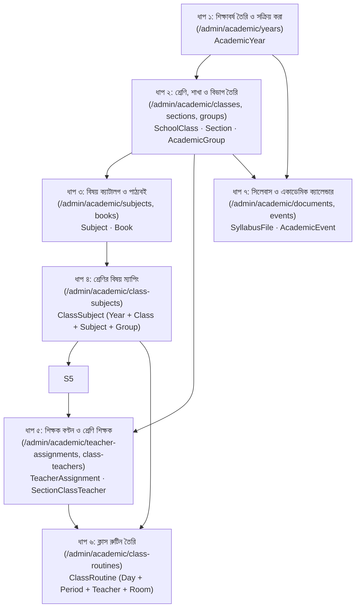
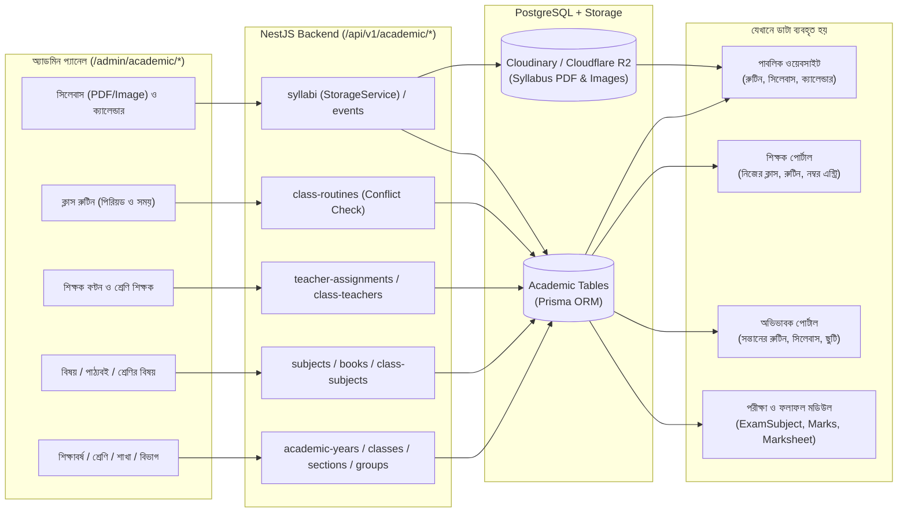
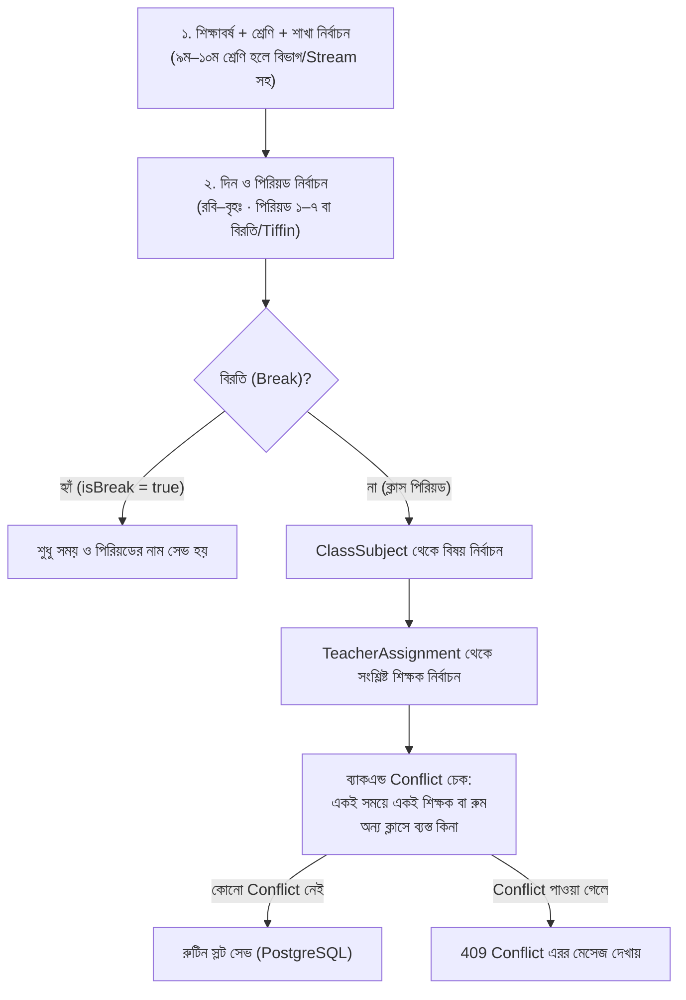

# একাডেমিক ও রুটিন (Academic & Routine) — সম্পূর্ণ ডাটা ফ্লো গাইড

এই ডকুমেন্টে **একাডেমিক ও রুটিন** সেকশনের সবগুলো সাব-পেজ কোনটার সাথে কোনটা যুক্ত এবং অ্যাডমিন কীভাবে ধাপে ধাপে সেটআপ করবেন—তা ভিজ্যুয়াল ডাটা ফ্লো ডায়াগ্রামসহ সহজভাবে দেখানো হয়েছে।

---

## ১. ধাপে ধাপে সেটআপ ফ্লো (কোনটার পর কোনটা করবেন)

রুটিন বা শিক্ষক বণ্টন করার আগে ভিত্তি (Foundation) ও পাঠ্যক্রম (Curriculum) তৈরি থাকতে হবে। নিচের ফ্লোচার্টটি অনুসরণ করলেই পুরো সিস্টেম একদম নির্ভুলভাবে কাজ করবে:

---

## ২. এন্ড-টু-এন্ড সিস্টেম ডাটা ফ্লো (Admin → Backend API → Database → Portals)

অ্যাডমিন প্যানেল থেকে ডাটা সেভ হলে কীভাবে ব্যাকএন্ড API হয়ে ডাটাবেজে যায় এবং সেখান থেকে পাবলিক ওয়েবসাইট, শিক্ষক ও অভিভাবক পোর্টালে দেখায়:

---

## ৩. ক্লাস রুটিন তৈরির ভেতরের ডাটা লজিক

একটি ক্লাস রুটিন স্লট (`ClassRoutine`) তৈরি করার সময় সিস্টেম স্বয়ংক্রিয়ভাবে যে ডাটাগুলো মিলিয়ে নেয়:

---

## ৪. কুইক সেটআপ চেকলিস্ট (সহজ রেফারেন্স)

| ক্রম | মেনু নাম | কাজ কী | পূর্বশর্ত (আগে কী থাকতে হবে) |
| :--- | :--- | :--- | :--- |
| **১** | **শিক্ষাবর্ষ** | চলতি বছর তৈরি ও Active করা (যেমন: `2026`) | কোনোটি নয় |
| **২** | **শ্রেণি, শাখা ও বিভাগ** | শ্রেণি (৬ষ্ঠ–১০ম), শাখা (ক, খ) এবং বিজ্ঞান/মানবিক/ব্যবসায় বিভাগ | কোনোটি নয় |
| **৩** | **বিষয় তালিকা ও পাঠ্যবই** | মূল বিষয় (বাংলা, গণিত...) এবং শ্রেণিভিত্তিক বইয়ের তালিকা | শ্রেণি ও বিষয় |
| **৪** | **শ্রেণির বিষয়** | নির্দিষ্ট শিক্ষাবর্ষে কোন শ্রেণিতে কোন বিষয় পড়ানো হবে তা যুক্ত করা | শিক্ষাবর্ষ + শ্রেণি + বিষয় (+ বিভাগ) |
| **৫** | **শিক্ষক বণ্টন ও শ্রেণি শিক্ষক** | কোন শাখায় কে শ্রেণি শিক্ষক এবং কোন বিষয় কে পড়াবেন তা নির্ধারণ | শাখা + শ্রেণির বিষয় + সক্রিয় শিক্ষক |
| **৬** | **ক্লাস রুটিন** | রবি–বৃহস্পতিবার পর্যন্ত পিরিয়ড, সময়, বিষয়, শিক্ষক ও রুম সেট করা | শাখা + শ্রেণির বিষয় + শিক্ষক বণ্টন |
| **৭** | **সিলেবাস ও একাডেমিক ক্যালেন্ডার** | শ্রেণিভিত্তিক সিলেবাস PDF/Image আপলোড ও ছুটির/ইভেন্টের তারিখ যোগ | শিক্ষাবর্ষ + শ্রেণি |
