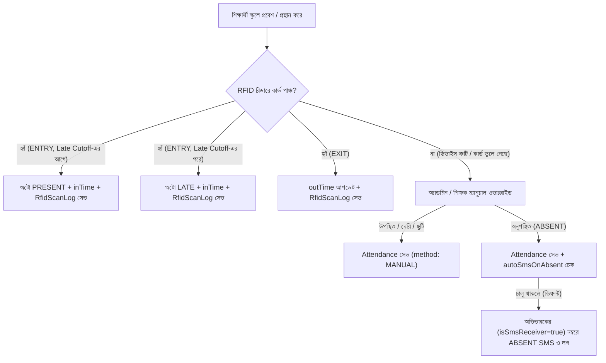

# হাজিরা ও SMS (Attendance & SMS) — সম্পূর্ণ আপডেটেড গাইড ও অ্যাকশন রেফারেন্স

এই ডকুমেন্টে অ্যাডমিন প্যানেলের **হাজিরা ও SMS (`/admin/attendance`)** সেকশনের বর্তমান প্রোডাকশন সিস্টেমের প্রতিটি পেজ, ট্যাব, ফিল্টার, বাটন, ব্যাকএন্ড API এবং প্রতিটি অ্যাকশনে ডাটাবেজ ও SMS-এ কী ঘটে—তার পূর্ণাঙ্গ বিবরণ দেওয়া হয়েছে।

> **আর্কিটেকচার নোট:** এই সেকশনে কোনো মক বা ফলব্যাক ডাটা নেই। সকল প্যাজিনেশন, সার্চিং এবং ফিল্টারিং **ব্যাকএন্ড (`edu-backend` + PostgreSQL/Prisma)** থেকে পরিচালিত হয় এবং ফ্রন্টএন্ড শুধুমাত্র ডাটা ভিজ্যুয়ালাইজ করে।

---

## ১. সামগ্রিক সিস্টেম ফ্লো (System Overview)

---

## ২. ৪টি সাব-পেজের তালিকা (Sidebar Navigation)

| ক্রম | পেজের নাম | URL রুট | মূল কাজ |
| :--- | :--- | :--- | :--- |
| ১ | **দৈনিক হাজিরা ও গেট** | `/admin/attendance/daily` | শ্রেণিভিত্তিক দৈনিক হাজিরা, ম্যানুয়াল সংশোধন, লাইভ RFID গেট পাঞ্চ ও অচিহ্নিত তালিকা |
| ২ | **মাসিক উপস্থিতি রিপোর্ট** | `/admin/attendance/reports` | মাসিক শিক্ষার্থীভিত্তিক রিপোর্ট, `<৭৫%` ঝুঁকিপূর্ণ তালিকা, শ্রেণি সারসংক্ষেপ, প্রিন্ট ও CSV |
| ৩ | **হাজিরা এসএমএস লগ** | `/admin/attendance/sms-logs` | প্রেরিত/ব্যর্থ SMS লগ, মেসেজ প্রিভিউ এবং সিঙ্গেল বা ব্যাচ রিট্রাই |
| ৪ | **হাজিরা নিয়ম ও সময়সীমা** | `/admin/attendance/settings` | শ্রেণিভিত্তিক দেরির সময়সীমা (`Late Cutoff`), মোড (`RFID`/`MANUAL`), কার্ড কাভারেজ ও SMS টগল |

*(প্রতিটি পেজের উপরে থাকা **শিক্ষাবর্ষ সিলেক্টর** থেকে চলতি বা পূর্ববর্তী শিক্ষাবর্ষ পরিবর্তন করা যায়।)*

---

## ৩. পেজ-ভিত্তিক বিস্তারিত বিশ্লেষণ (কোন অ্যাকশনে কী ঘটে)

### পেজ ১: দৈনিক হাজিরা ও গেট (`/admin/attendance/daily`)

উপরে **২টি মূল ট্যাব** এবং ডানদিকে **তারিখ স্টেপার (`<` | তারিখ | `>`)** রয়েছে:
- **তারিখ স্টেপার:** যেকোনো তারিখ (`আজ` বা পূর্ববর্তী দিন) সিলেক্ট করা যায়; ভবিষ্যতের তারিখ ব্লক থাকে।
- **বন্ধের দিন সতর্কবার্তা:** শুক্র/শনি বা একাডেমিক ক্যালেন্ডারে `HOLIDAY` থাকলে হলুদ সতর্কবার্তা দেখায়, তবে জরুরি প্রয়োজনে ম্যানুয়াল সংশোধন করা যায়।
- **৫টি স্ট্যাটাস কার্ড (KPI):** `মোট শিক্ষার্থী`, `উপস্থিত`, `দেরি`, `অনুপস্থিত`, এবং `অচিহ্নিত / ছুটি` (সাথে সাব-হেডারে `RFID` বনাম `ম্যানুয়াল` সংখ্যা)।

#### ট্যাব ক: `শ্রেণিভিত্তিক দৈনিক হাজিরা`
- **ফিল্টারসমূহ (ব্যাকএন্ড-চালিত):**
  - **সার্চ:** নাম (বাংলা/ইংরেজি), রোল নম্বর, স্টুডেন্ট আইডি বা RFID কার্ড নম্বর।
  - **শ্রেণি ও শাখা:** নির্দিষ্ট শ্রেণি বা শাখা অনুযায়ী ফিল্টার।
  - **অবস্থা:** `সব অবস্থা`, `উপস্থিত`, `দেরি`, `অনুপস্থিত`, `ছুটি`, `অচিহ্নিত`।
- **প্যাজিনেশন:** প্রতি পাতায় **২৫ জন** শিক্ষার্থী (`পূর্ববর্তী` / `পরবর্তী`)।

| বাটন / অ্যাকশন | কী ঘটে? |
| :--- | :--- |
| **সারির `উপ.` / `অনু.` / `দেরি` / `ছুটি` বাটন** | লোকাল ড্রাফটে স্ট্যাটাস পরিবর্তন করে এবং উপরে `সংরক্ষণ করুন (N)` বাটন সক্রিয় হয়। **সেভ না করা পর্যন্ত ডাটাবেজে যায় না বা SMS যায় না।** |
| **মন্তব্য ইনপুট (`মন্তব্য...`)** | ঐ শিক্ষার্থীর জন্য কারণ বা নোট (যেমন: *"অসুস্থ"*, *"ডিভাইস ত্রুটি"*) যোগ করে। |
| **`সবাইকে উপস্থিত`** | বর্তমান পাতার দৃশ্যমান সব শিক্ষার্থীর ড্রাফট এক ক্লিকে `উপস্থিত` করে। |
| **`সবাইকে অনুপস্থিত`** | বর্তমান পাতার দৃশ্যমান সব শিক্ষার্থীর ড্রাফট এক ক্লিকে `অনুপস্থিত` করে। |
| **`রিসেট`** | সেভ না করা সব পরিবর্তন বাতিল করে আগের অবস্থায় ফিরিয়ে আনে। |
| **`সংরক্ষণ করুন (N)`** | `POST /api/v1/attendance/batch` কল করে ডাটাবেজে সেভ করে (`method: MANUAL`, `markedBy: currentUserId`)। যাদের `ABSENT` সেভ হয়েছে এবং শ্রেণির `autoSmsOnAbsent` চালু আছে, তাদের অভিভাবকের কাছে **স্বয়ংক্রিয় SMS** পাঠায় (একই দিনে ডুপ্লিকেট SMS যায় না)। |
| **`CSV`** | বর্তমান পাতার হাজিরা তালিকা CSV ফাইল হিসেবে ডাউনলোড করে। |

#### ট্যাব খ: `লাইভ গেট ফিড ও বাকি তালিকা`
উপরে থাকে **লাইভ RFID গেট রিডার মনিটর বার**:
- আজকের মোট স্ক্যান, পরিচিত কার্ড ও অজানা কার্ডের সংখ্যা দেখায়।
- **কার্ড পাঞ্চ টেস্ট/ইনজেশন:** RFID কার্ড নম্বর লিখে দিক (`ENTRY` বা `EXIT`) বেছে **`কার্ড পাঞ্চ করুন`** ক্লিক করলে `POST /api/v1/attendance/rfid/simulate` কল হয়:
  - পরিচিত ও সক্রিয় কার্ড হলে `RfidScanLog` তৈরি হয়, শ্রেণির `lateThresholdTime` অনুযায়ী অটো `PRESENT` বা `LATE` (বা `EXIT`-এ `outTime`) রেকর্ড হয় এবং `autoSmsOnEntry` / `autoSmsOnExit` চালু থাকলে অভিভাবকের কাছে SMS যায়।
  - অনিবন্ধিত কার্ড হলে অজানা কার্ড সতর্কবার্তা দেখায় ও `isKnownCard: false` লগ সেভ করে।

নিচে **২টি সাব-ট্যাব** রয়েছে (প্রতিটিতে ব্যাকএন্ড প্যাজিনেশন: **২০টি/পাতা**):
1. **`অচিহ্নিত / বাকি (N)`:**
   - **সার্চ, শ্রেণি, শাখা ফিল্টার:** কেবল এখনো হাজিরা না হওয়া (`UNMARKED`) শিক্ষার্থীদের দেখায়।
   - **`উপস্থিত (ম্যানুয়াল)`** (প্রতি সারিতে): এক ক্লিকে ওই শিক্ষার্থীকে সরাসরি `PRESENT` (`MANUAL`) সেভ করে (কোনো SMS যায় না) এবং বাকি তালিকা থেকে সরিয়ে দেয়।
   - **`এই পাতার N জনকে অনুপস্থিত + SMS`:** কনফার্মেশন মডাল ওপেন করে; নিশ্চিত করলে ওই পাতার সব অচিহ্নিত শিক্ষার্থীকে `ABSENT` সেভ করে ও অভিভাবকদের কাছে SMS পাঠায়।
2. **`গেট স্ক্যান ফিড`:**
   - **সার্চ, দিক (`ENTRY`/`EXIT`), কার্ডের ধরন (`পরিচিত`/`অজানা`) ফিল্টার:** কাঁচা গেট পাঞ্চ লগ দেখায়।
   - **`CSV এক্সপোর্ট`:** বর্তমান পাতার স্ক্যান লগ ডাউনলোড করে।

---

### পেজ ২: মাসিক উপস্থিতি রিপোর্ট (`/admin/attendance/reports`)

উপরে **২টি ভিউ ট্যাব**, **মাস সিলেক্টর (`YYYY-MM`)**, **`প্রিন্ট`** এবং **`CSV এক্সপোর্ট`** বাটন রয়েছে:

1. **`শিক্ষার্থীভিত্তিক রিপোর্ট`:**
   - **৪টি KPI কার্ড:** `কার্যদিবস`, `গড় উপস্থিতি (%)`, `মোট শিক্ষার্থী`, `ঝুঁকিপূর্ণ (<৭৫%)`।
   - **ফিল্টার (ব্যাকএন্ড-চালিত):** সার্চ (নাম/রোল/আইডি), শ্রেণি, শাখা এবং **`শুধু <৭৫% ঝুঁকিপূর্ণ`** চেকবক্স।
   - **টেবিল ও প্যাজিনেশন (২০টি/পাতা):** প্রতিটি শিক্ষার্থীর `উপস্থিত`, `দেরি`, `অনুপস্থিত`, `ছুটি`, উপস্থিতির হার (`%` ও রঙিন প্রোগ্রেস বার) এবং `<৭৫%` হলে `ঝুঁকি` ব্যাজ দেখায়।
2. **`শ্রেণিভিত্তিক সারসংক্ষেপ`:**
   - প্রতিটি শ্রেণির মোট শিক্ষার্থী, মোট উপস্থিত, দেরি, অনুপস্থিত, ছুটি এবং শ্রেণির গড় উপস্থিতির হার (`%`) দেখায়।

---

### পেজ ৩: হাজিরা এসএমএস লগ (`/admin/attendance/sms-logs`)

- **৪টি KPI কার্ড:** `মোট SMS`, `সফল (Sent)`, `অপেক্ষমাণ (Pending)`, `ব্যর্থ (Failed)`।
- **ফিল্টার (ব্যাকএন্ড-চালিত):** সার্চ (নাম, মোবাইল বা বার্তা), স্ট্যাটাস (`ALL`/`SENT`/`PENDING`/`FAILED`), ধরন (`ALL`/`ABSENT`/`ENTRY`/`EXIT`) এবং তারিখ।
- **প্যাজিনেশন:** প্রতি পাতায় **২০টি** লগ।

| বাটন / অ্যাকশন | কী ঘটে? |
| :--- | :--- |
| **`বার্তা`** (প্রতি সারিতে) | **SMS বার্তা প্রিভিউ** মডাল খুলে প্রাপকের নাম, মোবাইল নম্বর, শিক্ষার্থী, স্ট্যাটাস এবং সম্পূর্ণ বাংলা SMS টেক্সট দেখায়। |
| **`পুনরায়`** (`FAILED` সারিতে) | `POST /api/v1/attendance/sms/retry` কল করে ঐ একটি ব্যর্থ SMS পুনরায় পাঠায় ও স্ট্যাটাস `SENT` করে। |
| **`সব ব্যর্থ পাঠান (N)`** (উপরে) | `POST /api/v1/attendance/sms/retry-all` কল করে সকল `FAILED` SMS একসাথে পুনরায় পাঠায়। |
| **`CSV এক্সপোর্ট`** | বর্তমান পাতার SMS লগ CSV হিসেবে ডাউনলোড করে। |

---

### পেজ ৪: হাজিরা নিয়ম ও সময়সীমা (`/admin/attendance/settings`)

- **৪টি KPI কার্ড:**
  1. `RFID শ্রেণি` (মোট শ্রেণির মধ্যে কতটিতে RFID চালু)।
  2. `সক্রিয় RFID কার্ড` (মোট সক্রিয় শিক্ষার্থীর মধ্যে কতজনের কার্ড আছে ও শতকরা হার)।
  3. `কার্ডবিহীন শিক্ষার্থী` (যাদের এখনো কার্ড ইস্যু হয়নি)।
  4. `SMS নীতি` (`অনুপস্থিতি ডিফল্ট`)।
- **শ্রেণিভিত্তিক টেবিল ও `সম্পাদনা` মডাল:**
  - **ডিফল্ট হাজিরা পদ্ধতি:** `RFID`, `MANUAL` অথবা `BIOMETRIC`।
  - **দেরির সময়সীমা (`HH:mm`):** যেমন `10:15` — এই সময়ের পর গেটে পাঞ্চ করলে অটো `LATE` হবে।
  - **SMS টগলসমূহ:** `অনুপস্থিতিতে অটো SMS` (ডিফল্ট ON), `প্রবেশে অটো SMS` (ঐচ্ছিক), `প্রস্থানে অটো SMS` (ঐচ্ছিক)।
  - শ্রেণিতে কার্ডবিহীন শিক্ষার্থী থাকলে মডালে সতর্কবার্তা দেখায়।
  - **`সংরক্ষণ করুন`** ক্লিক করলে `PUT /api/v1/attendance/config` কল হয়ে ডাটাবেজে সেভ হয়।

---

## ৪. ব্যাকএন্ড API এন্ডপয়েন্ট রেফারেন্স (`/api/v1/attendance`)

| মেথড | এন্ডপয়েন্ট | কাজ |
| :--- | :--- | :--- |
| `GET` | `/attendance/daily` | দৈনিক হাজিরা তালিকা, KPI ও বন্ধের দিন চেক (প্যাজিনেশন/সার্চ/ফিল্টারসহ) |
| `POST` | `/attendance/batch` | ব্যাচ হাজিরা সেভ ও স্বয়ংক্রিয় `ABSENT` SMS কিউ |
| `GET` | `/attendance/rfid/scans` | লাইভ RFID গেট স্ক্যান ফিড (প্যাজিনেশন/দিক/পরিচিত-অজানা ফিল্টারসহ) |
| `POST` | `/attendance/rfid/simulate` | RFID কার্ড পাঞ্চ রেকর্ড ও অটো হাজিরা/SMS ট্রিগার |
| `GET` | `/attendance/reports` | মাসিক শিক্ষার্থীভিত্তিক (`view=section`) ও শ্রেণি সারসংক্ষেপ (`view=summary`) রিপোর্ট |
| `GET` | `/attendance/sms-logs` | SMS লগ তালিকা ও KPI (প্যাজিনেশন/সার্চ/স্ট্যাটাস/ধরন/তারিখ ফিল্টারসহ) |
| `POST` | `/attendance/sms/retry` | একক ব্যর্থ SMS রিট্রাই |
| `POST` | `/attendance/sms/retry-all` | সকল ব্যর্থ SMS একসাথে রিট্রাই |
| `GET` | `/attendance/config` | শ্রেণিভিত্তিক নিয়ম ও RFID কার্ড কাভারেজ KPI |
| `PUT` | `/attendance/config` | শ্রেণিভিত্তিক হাজিরা ও SMS নিয়ম আপডেট |
