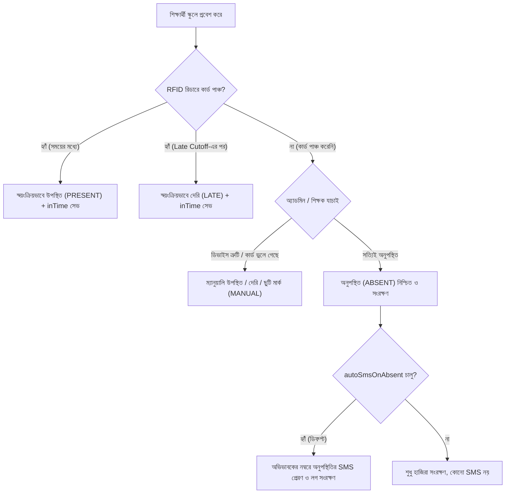

# হাজিরা ও SMS (Attendance & SMS) — সম্পূর্ণ কার্যপ্রণালী ও অ্যাকশন গাইড

এই ডকুমেন্টে অ্যাডমিন প্যানেলের **হাজিরা ও SMS (`/admin/attendance`)** সেকশনের প্রতিটি পেজ, ট্যাব, বাটন, ফিল্টার এবং প্রতিটি অ্যাকশনের ফলে ব্যাকগ্রাউন্ডে কী ঘটে—তার পূর্ণাঙ্গ বিবরণ দেওয়া হয়েছে।

---

## ১. সামগ্রিক সিস্টেম ফ্লো (System Overview)

আমাদের হাজিরা সিস্টেমটি **ডিভাইস-প্রথম (RFID Automated)**, তবে জরুরি অবস্থায় **ম্যানুয়াল ফল্ট-হ্যান্ডলিং** এবং **খরচ-সাশ্রয়ী অনুপস্থিত SMS** নীতির ওপর ভিত্তি করে তৈরি:

### মূল ৩টি নীতি:
1. **ডিফল্ট অটোমেটেড (RFID / বায়োমেট্রিক):** গেটের রিডারে কার্ড পাঞ্চ করলে স্বয়ংক্রিয়ভাবে `PRESENT` বা `LATE` রেকর্ড হবে (এবং বিকেলে/প্রস্থানে পাঞ্চ করলে `outTime` আপডেট হবে)।
2. **ডিভাইস ফল্ট বা ব্যতিক্রমে ম্যানুয়াল ওভাররাইড:** রিডার নষ্ট হলে বা শিক্ষার্থী কার্ড আনতে ভুলে গেলে অ্যাডমিন/শিক্ষক যেকোনো সময় ম্যানুয়ালি উপস্থিত, অনুপস্থিত, দেরি বা ছুটি মার্ক করতে পারবেন।
3. **খরচ-সাশ্রয়ী ও নির্ভুল SMS:** বাই ডিফল্ট প্রবেশ/প্রস্থানে কোনো SMS যাবে না—**শুধুমাত্র শিক্ষার্থী অনুপস্থিত (`ABSENT`) হলেই** তার নিবন্ধিত অভিভাবকের (`isSmsReceiver = true`) নম্বরে SMS যাবে।

---

## ২. সাইডবার মেনু কাঠামো

**হাজিরা ও SMS** মেনুতে মোট **৪টি স্বতন্ত্র পেজ** রয়েছে:

| ক্রম | পেজের নাম | URL রুট | মূল কাজ |
| :--- | :--- | :--- | :--- |
| ১ | **দৈনিক হাজিরা** | `/admin/attendance/daily` | শ্রেণিভিত্তিক দৈনিক হাজিরা, ম্যানুয়াল সংশোধন, লাইভ গেট ফিড ও অনুপস্থিত SMS |
| ২ | **মাসিক রিপোর্ট** | `/admin/attendance/reports` | মাসভিত্তিক উপস্থিতির হার, <৭৫% ঝুঁকিপূর্ণ শিক্ষার্থী, প্রিন্ট ও CSV |
| ৩ | **এসএমএস লগ** | `/admin/attendance/sms-logs` | অভিভাবকদের কাছে পাঠানো SMS-এর ইতিহাস, স্ট্যাটাস ও ব্যর্থ SMS রিট্রাই |
| ৪ | **নিয়ম ও সময়সীমা** | `/admin/attendance/settings` | দেরির সময়সীমা (Late Cutoff), RFID কার্ড কাভারেজ ও SMS নীতি |

---

## ৩. পেজ-ভিত্তিক বিস্তারিত বিশ্লেষণ (কোন অ্যাকশনে কী ঘটে)

### পেজ ১: দৈনিক হাজিরা ও গেট (`/admin/attendance/daily`)

এই পেজের একদম উপরে **২টি মূল ট্যাব** রয়েছে:
- **ট্যাব ক:** `শ্রেণিভিত্তিক দৈনিক হাজিরা`
- **ট্যাব খ:** `লাইভ গেট ফিড ও বাকি তালিকা`

#### ট্যাব ক: শ্রেণিভিত্তিক দৈনিক হাজিরা (`DailyRegister`)

##### উপরের ৪টি স্ট্যাটাস কার্ড (KPI):
1. **শাখার উপস্থিতির হার:** নির্বাচিত শাখার `((উপস্থিত + দেরি) / চিহ্নিত শিক্ষার্থী) × ১০০`।
2. **অনুপস্থিত ও ছুটি:** নির্বাচিত শাখায় মোট অনুপস্থিত ও ছুটির সংখ্যা।
3. **অচিহ্নিত / অপেক্ষমাণ:** যাদের এখনো কোনো হাজিরা মার্ক বা গেট পাঞ্চ হয়নি।
4. **বিদ্যালয়ব্যাপী সম্পন্ন শাখা:** পুরো স্কুলের কতটি শাখার হাজিরা সম্পন্ন হয়েছে এবং সামগ্রিক উপস্থিতির হার।

##### ফিল্টার ও কন্ট্রোল বার:
- **তারিখ স্টেপার (`<` | তারিখ | `>` | `সর্বশেষ দিন`):** যেকোনো খোলা দিনের তারিখ বেছে নেওয়া যায়। *(শুক্র/শনি বা একাডেমিক ক্যালেন্ডারের ছুটির দিন হলে সিস্টেম স্বয়ংক্রিয়ভাবে সতর্কবার্তা দেখায় ও সেভ করা ব্লক করে)।*
- **শ্রেণি ও শাখা সিলেক্টর:** নির্দিষ্ট শ্রেণি ও শাখার শিক্ষার্থীদের তালিকা লোড করে।
- **শিক্ষার্থী খুঁজুন:** রোল, বাংলা/ইংরেজি নাম, স্টুডেন্ট আইডি অথবা RFID কার্ড নম্বর দিয়ে ফিল্টার করে।
- **অবস্থা ফিল্টার:** `সব`, `অচিহ্নিত`, `উপস্থিত`, `অনুপস্থিত`, `দেরি`, বা `ছুটি` অনুযায়ী তালিকা ফিল্টার করে।

##### অ্যাকশন বাটনসমূহ (প্রতিটি ক্লিকে কী ঘটে):
| বাটন / অ্যাকশন | কী ঘটে? |
| :--- | :--- |
| **সারির `উপস্থিত` / `অনুপস্থিত` / `দেরি` / `ছুটি` বাটন** | শুধুমাত্র লোকাল ড্রাফটে স্ট্যাটাস পরিবর্তন করে (সারিটি হালকা হাইলাইট হয় এবং অসংরক্ষিত পরিবর্তনের সংখ্যা দেখায়)। **সাথে সাথে সেভ বা SMS যায় না।** |
| **মন্তব্য ইনপুট (`কারণ বা নোট...`)** | যেমন: *"ডিভাইস ত্রুটি"*, *"অসুস্থ"*, *"কার্ড বাসায়"* ইত্যাদি নোট লেখা যায়। |
| **`সব উপস্থিত` (দ্রুত বাটন)** | ঐ শাখার সব শিক্ষার্থীর ড্রাফট স্ট্যাটাস এক ক্লিকে `উপস্থিত` করে দেয় (ডিভাইস নষ্ট হলে খুব দ্রুত পুরো ক্লাস উপস্থিত করার জন্য)। |
| **`অচিহ্নিত অনুপস্থিত` (দ্রুত বাটন)** | শাখার যেসব শিক্ষার্থীর স্ট্যাটাস এখনো ফাঁকা, শুধু তাদের `অনুপস্থিত` হিসেবে ড্রাফটে মার্ক করে। |
| **`রিসেট`** | সেভ করার আগে করা সব অসংরক্ষিত পরিবর্তন বাতিল করে আগের অবস্থায় ফিরিয়ে আনে। |
| **`সংরক্ষণ করুন`** | ১) সকল মার্ক করা সারি ব্যাকএন্ডে পাঠিয়ে ডাটাবেজে সেভ করে (ম্যানুয়ালি পরিবর্তিত সারিগুলো `MANUAL` এবং ডিভাইস থেকে আসা অপরিবর্তিত সারি `RFID` হিসেবে থাকে)। ২) যাদের `অনুপস্থিত (ABSENT)` হিসেবে সেভ করা হয়েছে, নিয়ম চালু থাকলে তাদের অভিভাবকের নম্বরে **স্বয়ংক্রিয় SMS কিউ/প্রেরণ** হয়। |
| **`CSV ডাউনলোড`** | বর্তমান শাখার তারিখভিত্তিক হাজিরা (`রোল`, `নাম`, `অবস্থা`, `প্রবেশ/প্রস্থান সময়`, `পদ্ধতি`, `মন্তব্য`) CSV ফাইল হিসেবে ডাউনলোড করে। |

---

#### ট্যাব খ: লাইভ গেট ফিড ও বাকি তালিকা (`GateMonitor`)

এই ট্যাবের উপরের Status Bar-এ তারিখ পরিবর্তন এবং **`কার্ড তালিকা`** (`/admin/students/rfid-cards`) ও **`সময় ও SMS নিয়ম`** (`/admin/attendance/settings`)-এ যাওয়ার লিংক থাকে। নিচে **২টি সাব-ট্যাব** রয়েছে:

##### ১. `প্রবেশ বাকি / অনুপস্থিত` সাব-ট্যাব:
এখানে সেসব শিক্ষার্থীর তালিকা দেখা যায় যারা এখনো গেটে কার্ড পাঞ্চ করেনি এবং যাদের ছুটিও নথিভুক্ত নেই।
- **ফিল্টার:** রোল/নাম/কার্ড সার্চ এবং শ্রেণি ফিল্টার।

| বাটন / অ্যাকশন | কী ঘটে? |
| :--- | :--- |
| **`উপস্থিত (ম্যানুয়াল)`** (প্রতি সারিতে) | যদি ডিভাইস ফল্ট করে বা শিক্ষার্থী কার্ড ছাড়া ক্লাসে আসে, এক ক্লিকে তাকে `PRESENT` (`MANUAL`) হিসেবে সরাসরি সেভ করে। **কোনো SMS যায় না।** |
| **`অনুপস্থিত`** (প্রতি সারিতে) | শিক্ষার্থীকে সরাসরি `ABSENT` হিসেবে সেভ করে এবং নিয়ম চালু থাকলে তার অভিভাবককে অনুপস্থিতির SMS পাঠায়। |
| **`বাকি সবাইকে অনুপস্থিত চিহ্নিত করুন ও SMS পাঠান`** | সরাসরি কাজ না করে **মিডল পয়েন্টে কনফার্মেশন মডাল** ওপেন করে সতর্ক করে: *"গেটের RFID ডিভাইস সচল ছিল কিনা নিশ্চিত হয়ে নিন"*। কনফার্ম করলে অপেক্ষমাণ সবাইকে `ABSENT` সেভ করে এবং অভিভাবকদের কাছে অনুপস্থিতির SMS পাঠায়। |

##### ২. `গেট স্ক্যান লগ` সাব-ট্যাব:
গেটের RFID রিডারে আসা প্রতিটি কাঁচা পাঞ্চের লাইভ ফিড দেখায়।
- **ফিল্টার:** দিক (`সব দিক` / `প্রবেশ (ENTRY)` / `প্রস্থান (EXIT)`), কার্ডের ধরন (`পরিচিত কার্ড` / `অপরিচিত কার্ড`) ও সার্চ।
- **`CSV ডাউনলোড`:** গেট স্ক্যান ফিডের সম্পূর্ণ লগ CSV হিসেবে ডাউনলোড করে।

---

### পেজ ২: মাসিক রিপোর্ট (`/admin/attendance/reports`)

- **ভিউ সুইচার:**
  1. **`শাখাভিত্তিক বিস্তারিত`:** নির্দিষ্ট মাস, শ্রেণি ও শাখা অনুযায়ী প্রতিটি শিক্ষার্থীর `উপস্থিত`, `দেরি`, `অনুপস্থিত`, `ছুটি`, `মোট কার্যদিবস` এবং **উপস্থিতির হার (%)** দেখায়।
  2. **`সকল শ্রেণির সারসংক্ষেপ`:** পুরো স্কুলের প্রতিটি শ্রেণি ও শাখার মোট উপস্থিতি, গড় হার এবং ৭৫%-এর নিচে থাকা শিক্ষার্থীর সংখ্যা একসাথে দেখায়।
- **ফিল্টার:** মাস (`YYYY-MM`), নাম/রোল/আইডি সার্চ, এবং **`৭৫%-এর কম (ঝুঁকিপূর্ণ)`** টগল বাটন (ক্লিক করলে কেবল অ্যাটেনডেন্স শর্ট থাকা শিক্ষার্থীরা ফিল্টার হয়ে আসে)।
- **অ্যাকশন:** **`প্রিন্ট`** (প্রিন্ট-ফ্রেন্ডলি রিপোর্ট) এবং **`CSV ডাউনলোড`**।

---

### পেজ ৩: এসএমএস লগ (`/admin/attendance/sms-logs`)

##### উপরের ৪টি স্ট্যাটাস কার্ড (KPI):
1. **মোট প্রেরিত লগ:** সিস্টেমে রেকর্ড হওয়া মোট SMS সংখ্যা।
2. **সফলভাবে প্রেরিত:** `SENT` হওয়া SMS এবং ডেলিভারি সাফল্যের হার (%)।
3. **ব্যর্থ (পুনরায় পাঠান):** নেটওয়ার্ক বা গেটওয়ে সমস্যার কারণে `FAILED` হওয়া SMS সংখ্যা।
4. **ধরনভিত্তিক বিভাজন:** অনুপস্থিতি SMS বনাম গেট এন্ট্রি/এক্সিট SMS।

##### ফিল্টার ও অ্যাকশনসমূহ:
| বাটন / অ্যাকশন | কী ঘটে? |
| :--- | :--- |
| **ফিল্টার (`অবস্থা`, `ধরন`, `তারিখ`, `সার্চ`)** | `প্রেরিত` / `ব্যর্থ` / `অপেক্ষমাণ`, বা `অনুপস্থিতি` / `গেট প্রবেশ` / `গেট প্রস্থান`, বা নির্দিষ্ট তারিখ অনুযায়ী লগ ফিল্টার করে। |
| **মেসেজ প্রিভিউ (মেসেজ টেক্সটে ক্লিক)** | মডালে প্রাপকের নাম, মোবাইল নম্বর, সময় এবং পুরো বাংলা SMS টেক্সট দেখায়। |
| **`পুনরায় পাঠান` (প্রতি ব্যর্থ সারিতে)** | শুধুমাত্র ঐ একটি ব্যর্থ SMS গেটওয়ে দিয়ে পুনরায় পাঠানোর চেষ্টা করে। |
| **`সব ব্যর্থ পুনরায় পাঠান` (ব্যাচ রিট্রাই)** | সকল `FAILED` স্ট্যাটাসের SMS একসাথে পুনরায় পাঠানোর চেষ্টা করে। |
| **`CSV ডাউনলোড`** | ফিল্টার করা SMS লগের তালিকা CSV আকারে এক্সপোর্ট করে। |

---

### পেজ ৪: নিয়ম ও সময়সীমা (`/admin/attendance/settings`)

##### উপরের ৪টি স্ট্যাটাস কার্ড (KPI):
1. **RFID অটোমেটেড শ্রেণি:** কতটি শ্রেণি স্বয়ংক্রিয় RFID মোডে আছে।
2. **ম্যানুয়াল ফল্ট ব্যাকআপ:** সর্বদা সক্রিয় (ডিভাইস ত্রুটিতে হাতে সংশোধনযোগ্য)।
3. **RFID কার্ড কাভারেজ:** মোট সক্রিয় শিক্ষার্থীর কত শতাংশের কাছে অ্যাক্টিভ RFID কার্ড ইস্যু করা আছে।
4. **অনুপস্থিতি SMS (ডিফল্ট):** কতটি শ্রেণিতে অনুপস্থিতির অটো SMS চালু আছে।

##### টেবিল ও এডিট মডাল (`পরিবর্তন` বাটনে ক্লিক করলে কী হয়):
প্রতিটি শ্রেণির জন্য আলাদাভাবে নিচের নিয়মগুলো সেট করা যায়:
- **দেরির সময়সীমা (`Late Cutoff`, যেমন `10:15`):** এই সময়ের পরে কার্ড পাঞ্চ করলে শিক্ষার্থীকে স্বয়ংক্রিয়ভাবে `উপস্থিত`-এর বদলে `দেরি (LATE)` হিসেবে গণ্য করা হবে।
- **অনুপস্থিতিতে অটো SMS (`autoSmsOnAbsent`):** ডিফল্ট **চালু** থাকে। শিক্ষার্থী অনুপস্থিত চিহ্নিত হলে অভিভাবকের কাছে SMS যাবে।
- **ঐচ্ছিক গেট SMS (`autoSmsOnEntry` / `autoSmsOnExit`):** খরচ সাশ্রয়ের জন্য ডিফল্ট **বন্ধ** থাকে; প্রয়োজনে নির্দিষ্ট শ্রেণির জন্য চালু করা যাবে।
- যদি ঐ শ্রেণির কোনো শিক্ষার্থীর RFID কার্ড ইস্যু না করা থাকে, মডালে সতর্কবার্তা ও সরাসরি **`কার্ড ইস্যু পৃষ্ঠায় যান`** লিংক দেখাবে।

---

## ৪. বাস্তব পরিস্থিতিতে করণীয় (Quick Operational Guide)

1. **স্বাভাবিক দিন:** শিক্ষার্থীরা গেটে RFID কার্ড পাঞ্চ করবে → `দৈনিক হাজিরা` ও `লাইভ গেট ফিড`-এ অটোমেটিক `উপস্থিত`/`দেরি` দেখাবে। ক্লাস শুরুর পর নির্ধারিত সময়ে অ্যাডমিন `লাইভ গেট ফিড ও বাকি তালিকা` ট্যাবে গিয়ে নিশ্চিত হয়ে **`বাকি সবাইকে অনুপস্থিত চিহ্নিত করুন ও SMS পাঠান`** ক্লিক করলে অনুপস্থিতদের অভিভাবকের কাছে SMS চলে যাবে।
2. **যদি গেটের RFID ডিভাইস নষ্ট হয় বা বিদ্যুৎ না থাকে:**
   - ভুলেও `বাকি সবাইকে অনুপস্থিত` বাটনে ক্লিক করবেন না।
   - সরাসরি **`দৈনিক হাজিরা`** ট্যাবে গিয়ে শ্রেণি ও শাখা সিলেক্ট করুন → **`সব উপস্থিত`** (অথবা হাতে হাতে `উপস্থিত`/`অনুপস্থিত` মার্ক) করে **`সংরক্ষণ করুন`** ক্লিক করুন।
3. **যদি কোনো শিক্ষার্থী কার্ড বাসায় রেখে আসে:**
   - `বাকি তালিকা` থেকে তার নামের পাশে **`উপস্থিত (ম্যানুয়াল)`** ক্লিক করুন (অথবা `দৈনিক হাজিরা` থেকে `উপস্থিত` মার্ক করে মন্তব্যে *"কার্ড আনেনি"* লিখে সেভ করুন)।
4. **ছুটির দিন / সরকারি বন্ধ:** একাডেমিক ক্যালেন্ডারে `HOLIDAY` সেট করা থাকলে বা শুক্র/শনি হলে সিস্টেম নিজে থেকেই হাজিরা সেভ ও SMS পাঠানো বন্ধ রাখবে।
